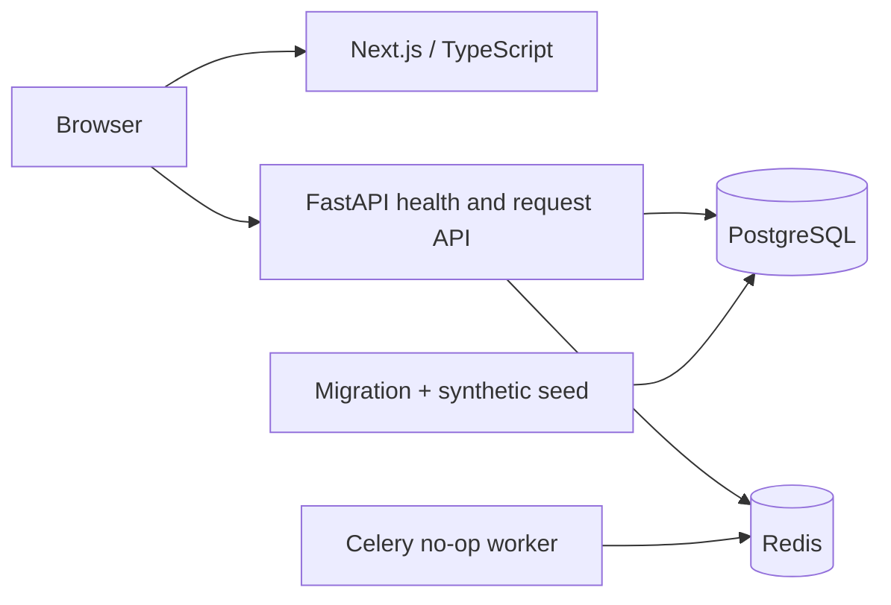

# ActionDesk

AI-assisted internal operations platform. Phase 0 provides the Next.js placeholder, health endpoints, tenant-aware PostgreSQL schema, deterministic synthetic fixtures, Redis, and a side-effect-free Celery worker. **Phase 1 milestone 1** adds the request creation/read persistence slice. Login, approvals, AI, notifications, and frontend workflows are not implemented.

**Current status:** Phase 0 is complete; its stack and CI verification remains recorded in [Phase 0 results](docs/PHASE_0_RESULTS.md). Phase 1 milestone 1 is authorized and implemented, with live PostgreSQL verification pending because this execution environment blocks Docker/socket access. See [milestone scope, API boundary, and actual checks](docs/PHASE_1_MILESTONE_1.md). Further milestones require explicit approval.

## Specification and decisions

[PRD v1.1](docs/ActionDesk_PRD_Technical_Architecture_v1_1.pdf) is authoritative; [v1](docs/ActionDesk_PRD_Technical_Architecture_v1.pdf) is background. [AGENTS.md](AGENTS.md), [Phase 0 plan](docs/PHASE_0_PLAN.md), and [foundation ADR](docs/adr/0001-foundation.md) describe engineering constraints and approved decisions. Phase 1 authorization is limited to milestone 1.

## Local setup

Run commands from the repository root. Prerequisites: Docker Engine/Desktop with Compose v2+ and a running daemon; Node.js 22+; npm; uv; Make; Git. uv manages Python 3.12. First downloads/image builds may take longer than ten minutes.

```sh
cp .env.example .env
make setup
make dev
```

`make setup` runs `uv sync`, `npm install`, and Chromium installation. The repository includes `uv.lock` and `package-lock.json`. Setup can update these lockfiles when manifests change; review any resulting diff. CI and Docker builds use frozen/clean installs (`uv sync --frozen`, `npm ci`).

After setup, **`make dev` is the one command to start the complete local stack**. It builds images, starts PostgreSQL and Redis, runs Alembic and the 100-request seed, then starts API, worker, and web. It waits for health checks; bootstrap failures block dependent services. The local development startup and CI-equivalent base startup have both passed verification.

`infra/compose.yaml` is the base configuration and has no host source mounts. Local Make targets add `infra/compose.local.yaml`, retaining source bind mounts/hot reload and the local Next.js cache volume. CI runs `make verify COMPOSE_FILES="-f infra/compose.yaml"`; recursive Make targets inherit that selection. The web image keeps `USER node` and its image-owned writable source directory, so CI never replaces it with a checkout owned by a different host UID. No root runtime or workspace permission changes are needed. Failure diagnostics and all health probes remain enabled.

- Web: http://127.0.0.1:3000
- API liveness: http://127.0.0.1:8000/health
- API readiness: http://127.0.0.1:8000/ready
- OpenAPI: http://127.0.0.1:8000/openapi.json and `/docs`

The example database password is for local synthetic development only. PostgreSQL and Redis have no host-published ports. API/web bind to localhost. Do not deploy this Compose file or share its credentials externally. Seed users are inactive, have no passwords, and cannot log in.

## Architecture



Web/API/worker are separate processes in one monorepo. API and worker share the Python package defined in root `pyproject.toml`. PostgreSQL owns workflow state, approvals, policies, history, and outbox records. Redis/Celery is transport; no durable business jobs, relay, AI calls, or notifications run in Phase 0.

`apps/api/app/domain` holds types and approved safety predicates; `db` contains SQLAlchemy models and fixture persistence. Request routers, typed schemas, and transaction services live in `api`, `schemas`, and `services`. Alembic revisions live in `apps/api/migrations`; milestone 1 adds `0002_request_foundation` without rewriting the original foundation migration. `packages/contracts` contains FastAPI OpenAPI and generated TS declarations. `data/seed/requests.json` is canonical synthetic input. Tests cover unit, PostgreSQL integration, and browser smoke checks.

## Schema and fixtures

The schema includes organizations, departments, users, a fixed role catalog, role assignments, employee managers, department managers, versioned approval policies, requests, typed fixture fields stored as JSONB, immutable request events, approvals, and an initial outbox table. Milestone 1 requires a department on each request and a matching history event for creation or status/version changes at transaction commit.

Roles are employee, manager, finance, and admin, with multiple assignments per user. Manager relationships reference manager-role assignments. Composite organization foreign keys prevent cross-organization references. The existing approvals schema identifies a role-qualified approver and constrains requester separation; no approval execution is implemented. Policy definitions identify roles/scopes and thresholds rather than individual users. Policy execution, login, cancellation/reversal, reopening, and payment-processing actions are deferred. See [tenant-integrity review](docs/TENANT_INTEGRITY.md) for the relationship map and [milestone 1 notes](docs/PHASE_1_MILESTONE_1.md) for the request API boundary.

Request endpoints are `POST /requests`, `GET /requests/{request_id}`, and `GET /requests`. They deny access with 401 until a trusted identity verifier is implemented; only tests install identity overrides. Client-supplied identity headers never grant access. Creation requires a UUID `Idempotency-Key` and a requester matching the trusted identity. Service requests start at `SUBMITTED`; expense/leave requests start at `DRAFT`. Get/list are restricted to the requester's own organization and records. There are no update or transition endpoints.

```sh
make migrate
make seed          # Default: 100 requests
make seed-smoke    # Additive 10-request subset; never reduces existing data
```

Seeds use stable UUIDs, fixed UTC timestamps, fictional `.invalid` addresses, and Decimal amounts serialized as strings. They run in one transaction under an advisory lock. Repeated commands preserve existing rows; they never reset requests or rewrite events. Fixture IDs and policy versions are immutable: intentional fixture changes should use new IDs/versions, not overwrite existing business history. Seed commands do not dispatch outbox jobs. No attachments or real customer data are present.

## Verification

```sh
make lint
make typecheck
make test
make contracts-check
make compose-check
make dev
make test-integration
make worker-smoke
make test-web
npm run build
```

`make verify` runs these checks as one sequence using the base + local override. To reproduce CI without host source mounts, select the base configuration explicitly:

```sh
make verify COMPOSE_FILES="-f infra/compose.yaml"
```

Both verification commands leave their stack running. Use `make down` for the local configuration or `make down COMPOSE_FILES="-f infra/compose.yaml"` for the base-only configuration. Integration checks create/migrate a temporary PostgreSQL database and drop only that generated database. Each database test uses its own fresh disposable database. Tests verify independent 10/100-record seed paths, repeat snapshots, safe downgrade/upgrade, deployed tables/FKs/uniques/indexes, 16 cross-organization references, role separation, append-only events, model/migration drift, and live PostgreSQL/Redis readiness. They require the local database role's ability to create test databases; do not run with production connection strings.

Browser smoke tests verify the served placeholder on desktop/mobile. Worker smoke checks ping and observes a no-op task success event; it does not claim durable job recovery. The CI workflow runs the same checks on Linux without AI keys. The project owner confirmed that GitHub Actions passed after the Compose mount split.

`/health` indicates process liveness independent of dependencies. `/ready` is 200 only when PostgreSQL responds, the database revision is the expected Alembic head, and Redis responds; otherwise it returns 503 with sanitized component statuses. It does not verify worker liveness; Compose has a separate worker probe. Each API response includes a validated/generated `X-Request-ID`. No request bodies, credentials, or dependency exception text are returned by health checks.

## API contracts

```sh
make contracts       # Export OpenAPI and regenerate TypeScript
make contracts-check # Compare without changing generated files
```

The generation command imports FastAPI without connecting to PostgreSQL/Redis. Source schemas remain Pydantic/OpenAPI; frontend types are generated, not separately hand-maintained.

The temporary converter has been removed. `scripts/contracts.mjs` now calls the approved `openapi-typescript` Node API. Generation and drift checks fail if that dependency is missing; there is no fallback. TypeScript contracts are generated from the actual FastAPI OpenAPI schema. Generation and drift checks are included in the passing foundation workflow.

Comparator tests deliberately change or remove artifact files to verify detection without overwriting them. Real-generator tests additionally mutate an exported FastAPI schema and test CLI exit status; these are skipped when `openapi-typescript` is absent. Install the approved dependencies before verification; a missing generator also makes `make contracts-check` fail.

## Troubleshooting

- Docker socket denied or daemon unavailable: start Docker Desktop and run in an environment allowed to access its socket. `make compose-check` validates configuration without a daemon but does not prove startup.
- DNS/registry errors: setup needs access to PyPI, npm, and container registries. Resolve connectivity, then rerun `make setup`.
- Missing `uv.lock`: restore the tracked lockfile from Git. Backend Docker builds and CI intentionally require it; intentional dependency changes require regenerating and reviewing the lock.
- Port binding denied: local execution needs permission to listen on localhost. Choose available `WEB_PORT`/`API_PORT` in `.env`; for browser tests set `WEB_BASE_URL` accordingly.
- Bootstrap exits: inspect `make logs` for migration/seed failure. Do not bypass migration ordering or use `create_all`.
- Readiness 503: inspect component statuses and Compose service health; rerun `make migrate` for a revision mismatch after reviewing migrations. Do not edit `alembic_version` manually.
- Changed PostgreSQL password with an existing volume: initialization variables only apply to a new database. Restore the local value or intentionally manage the existing database credentials.
- Missing `openapi-typescript` or npm lock mismatch: restore registry access and rerun `make setup`; review the updated npm lock, regenerate with `make contracts`, then run `make contracts-check`.
- Contract drift: regenerate with the installed intended package, review the schema/type diff, and rerun the checks.
- User cannot log in: Phase 0 has no authentication feature. Do not enable seed passwords as a workaround.
- `make down` stops containers and preserves data. `docker compose --env-file .env -f infra/compose.yaml -f infra/compose.local.yaml down --volumes` deletes local data and the local Next.js cache and is an explicit destructive reset, never part of normal startup.

No AWS deployment, external AI integration, real-user onboarding, or paid services are part of this foundation.
